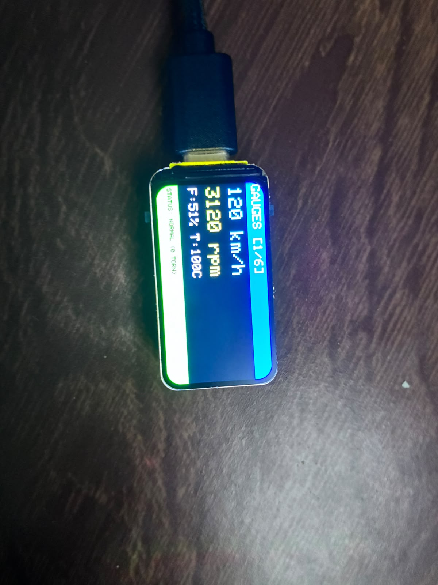

# ICM — Instrument Cluster Module on Trampoline RTOS

**Project #2 — Automotive Instrument Cluster Module Using Trampoline RTOS**  
Sistemas Embarcados, PPGEE UTFPR Ponta Grossa — Prof. Max Mauro Dias Santos  

**Equipe:** Osvaldo Janeri Filho (@ojaneri) · Norton Dezonet (@dezonet) · Vinicius Antunes

[](https://github.com/ojaneri/ee-icm-trampoline/actions/workflows/ci.yml)
[](https://ojaneri.github.io/ee-icm-trampoline/)

Protótipo de painel de instrumentos automotivo com **controle determinístico de tempo real**: seis tarefas OSEK no [Trampoline RTOS](https://github.com/TrampolineRTOS/trampoline) (OSEK/VDX, API alinhada ao AUTOSAR OS 4.2), entrada CAN com interrupção e evento, estrutura de dados compartilhada sob protocolo de teto de prioridade, diagnóstico de falhas e **deploy em hardware real**.

### 🌐 [Acesse a Demonstração Interativa e Documentação Completa](https://ojaneri.github.io/ee-icm-trampoline/)
Simulação do display LCD, guia de conexão Wi-Fi e documentação técnica do projeto.

<p align="center">
  
  <br><em>Placa real na tela 1/6 · <a href="https://youtube.com/shorts/D06m8DS3zdU">vídeo das telas em funcionamento</a></em>
</p>

---

## Onde cada parte roda

| Parte | Alvo | O que faz |
|---|---|---|
| **Cluster sobre Trampoline RTOS** (`src/`) | Alvo POSIX do Trampoline (Linux), CAN em `vcan0` | As 6 tarefas OSEK, ISR, eventos, alarmes e recursos. **Todas as medições de tempo real deste README vêm daqui** (ver `docs/relatorio_tecnico.md`) |
| **Painel físico** (`esp32_dashboard/`) | Waveshare ESP32-C6-LCD-1.47 (Arduino + PlatformIO) | Display ST7789 de 1.47" e interface web por Wi-Fi. Mostra um ciclo de condução simulado no próprio firmware; ainda não é alimentado pelo Trampoline |
| **Port para MCU** (`nucleo_l476/`) | STM32 Nucleo L476RG | Apenas um esqueleto (super-loop com stubs). O port do Trampoline é trabalho futuro (issue #3) |

### ESP32-C6: Dashboard Gráfico e Wi-Fi

Pinagem do display (Waveshare ESP32-C6-LCD-1.47, ST7789 172×320, SPI por hardware a 40 MHz):

| Sinal | MOSI | SCLK | CS | DC | RST | BL |
|---|---|---|---|---|---|---|
| GPIO | 6 | 7 | 14 | 15 | 21 | 22 |

Cada quadro é desenhado em um framebuffer em RAM e enviado de uma vez (sem cintilação). A cada 1 s o firmware reenvia a sequência de wake-up do painel, para recuperar o display caso uma descarga eletrostática (ex.: toque na placa) o reinicie. O log serial sai pela USB nativa (`ARDUINO_USB_CDC_ON_BOOT=1`).

O firmware da ESP32-C6 implementa um dashboard completo que roda localmente no display TFT de 1.47" e simultaneamente hospeda uma interface web via Wi-Fi Access Point.

#### Telas do display LCD (auto-rotação a cada 5 s)
1. **Gauges**: velocidade, rotação, combustível e temperatura. Barra de status verde (normal) ou vermelha com a mensagem de falha.
2. **Tasks**: contadores de ativação das tarefas e utilização de CPU.
3. **Jitter**: desvio do período nos últimos 8 jobs de aquisição (barra vermelha acima de 2 ms).
4. **ISR Latency**: interrupção real no botão BOOT (GPIO9, borda de descida). A ISR só registra o instante; o loop principal trata o evento e mede a latência ISR → tarefa. No boot, um autoteste gera uma borda no próprio GPIO9 e mede borda → ISR (≈ 5,7 µs).
5. **Debug**: deadlines perdidos, overruns, cópias rasgadas e estado da FIFO CAN.
6. **Network**: SSID, IP e porta WebSocket.

Ao apertar o BOOT, o LCD vai para a tela 4 e mostra a medição por 10 s.

#### Interface web (celular/PC)
Conecte-se ao Wi-Fi da placa e acesse a mesma informação em abas, com gráficos em Canvas atualizados via WebSocket. A aba só muda quando você clica nela.

---

## Como Reproduzir e Testar

### Pré-requisitos
- [PlatformIO Core](https://platformio.org/install/cli) ou VS Code com extensão PlatformIO
- Driver USB para ESP32-C6 e ST-Link para Nucleo (conforme aplicável)

### ESP32-C6 Dashboard
1. Conecte a placa via USB.
2. Compile e grave o firmware:
   ```bash
   platformio run -d esp32_dashboard --target upload
   ```
3. Abra o Monitor Serial (115200 baud) para ver os logs de boot e telemetria.
4. No seu celular ou PC, conecte na rede Wi-Fi:
   - **SSID:** `ICM-Dashboard-AP`
   - **Senha:** `12345678`
5. Acesse no navegador: **http://192.168.4.1**
6. Pressione o botão **BOOT** na placa: o LCD mostra a latência ISR → tarefa, e o log serial registra `BOOT IRQ #n`.

### Cluster sobre Trampoline (alvo POSIX)
Os passos completos (setup do Trampoline, `vcan0`, builds e coleta de evidências) estão na seção 13 de [`docs/relatorio_tecnico.md`](docs/relatorio_tecnico.md).

---

## Estrutura do Repositório

```
esp32_dashboard/      Firmware ESP32-C6 (Arduino/PlatformIO)
  src/main.cpp        Lógica completa: Display, Wi-Fi, WebSocket, Simulação RTOS
  platformio.ini      Configuração da placa e dependências
nucleo_l476/          Esqueleto para o futuro port na STM32 Nucleo L476RG
src/                  Aplicação Trampoline (OIL + C), alvo POSIX
sim/                  Simulador das ECUs no barramento CAN
tools/                Build, coleta de evidências e verificações do CI
docs/                 Relatório técnico e evidências de testes
requirements/         Requisitos, arquitetura e dicionário de sinais
tests/                Testes unitários e de integração (CI)
```

---

## Resultados de Tempo Real

Medições do cluster sobre Trampoline no alvo POSIX (evidências em `docs/evidence/`):

| Métrica | Resultado |
|---|---|
| Jobs iniciados no tick de liberação | 100 % |
| Deadlines perdidos (nominal e sob falhas de CAN) | 0 |
| Utilização de CPU | 2,9 % (limite de Liu & Layland para 6 tarefas: 73,5 %) |
| Cópias inconsistentes de `ICM_Data` | 0 de 617 com o recurso; 199 de 617 sem ele (controle negativo) |
| Latência de IRQ CAN, p99 | 0,139 ms (`SCHED_FIFO`) |
| Detecção da perda da M2 (período 1 s) | 3,102 s (esperado: > 3 s e ≤ 3,3 s) |

Na ESP32-C6, o autoteste da interrupção do GPIO9 mede ≈ 5,7 µs da escrita no pino até a entrada na ISR. Com o botão BOOT, a latência ISR → tarefa ficou em 108–191 µs em 4 de 5 toques e chegou a 25,9 ms em um. No super-loop do Arduino o tratamento espera o loop terminar o que está fazendo (desenhar um quadro, atender o Wi-Fi), porque não há preempção. É o problema que o escalonamento preemptivo por prioridade do RTOS resolve.

---

## Contributors

- Osvaldo Janeri Filho ([@ojaneri](https://github.com/ojaneri))
- Norton Dezonet ([@dezonet](https://github.com/dezonet))
- Vinicius Antunes

---

## Licença

Este projeto é desenvolvido para fins acadêmicos no PPGEE/UTFPR.