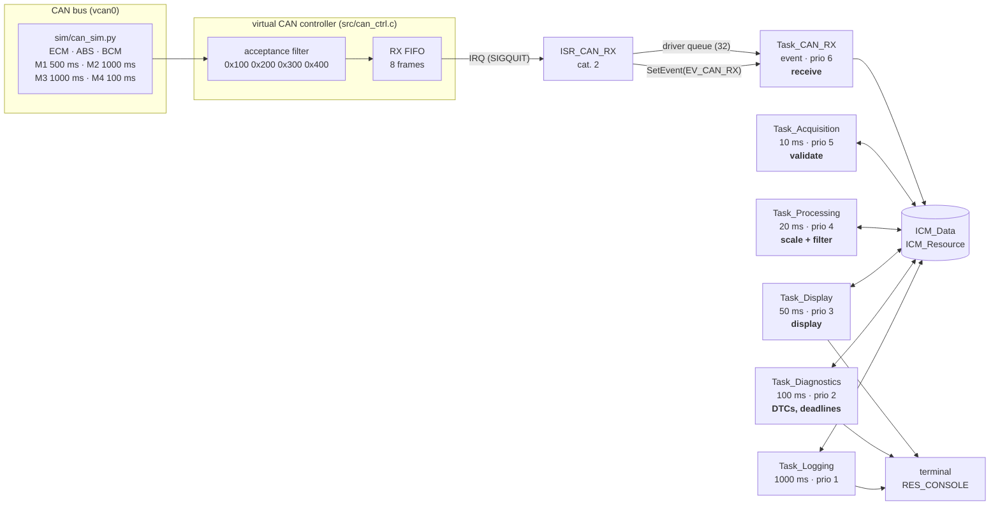
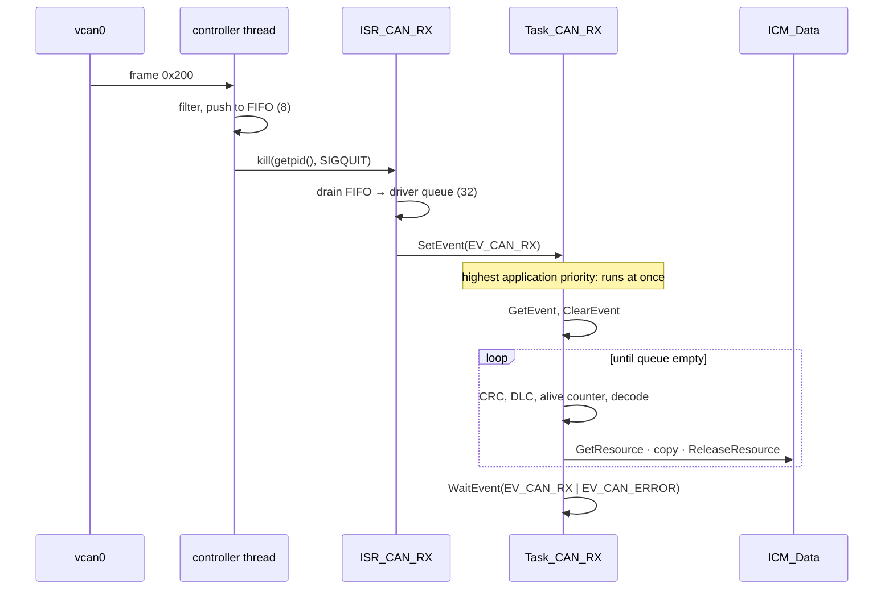

# ICM architecture: tasks, events, alarms, ISR, resources

Osvaldo Janeri Filho · Norton Dezonet (@dezonet) · Vinicius Antunes\
Project #2 — Automotive Instrument Cluster Module Using Trampoline RTOS

This document is the design behind `src/icm.oil` and `src/icm_app.c`. Every
OS object is listed with the reason it exists and the reason for its
parameters. Requirement identifiers refer to `icm_requirements.md`.

## 1. Overview

The professor's pipeline, receive → validate → scale → filter → display, is
one stage per task. Stages never call each other; each reads what the
previous stage left in ICM_Data and writes its own section. That keeps every
task's work bounded and independent of the others' timing, and it is what
makes the single-writer-per-section rule (section 5) possible.

## 2. OS objects

### 2.1 Tasks

| Task | Type | Activation | Period | OIL priority | Resources | Stage |
|---|---|---|---|---|---|---|
| Task_Init | basic | AUTOSTART | once | 10 | — | arms the alarms |
| Task_CAN_RX | **extended** | AUTOSTART, then `WaitEvent` | event | 6 | ICM_Resource | receive |
| Task_Acquisition | basic | ALARM_Acquisition | 10 ms | 5 | ICM_Resource | validate |
| Task_Processing | basic | ALARM_Processing | 20 ms | 4 | ICM_Resource | scale, filter |
| Task_Display | basic | ALARM_Display | 50 ms | 3 | ICM_Resource, RES_CONSOLE | display |
| Task_Diagnostics | basic | ALARM_Diagnostics | 100 ms | 2 | ICM_Resource, RES_CONSOLE | DTCs, deadline monitor |
| Task_Logging | basic | ALARM_Logging | 1000 ms | 1 | ICM_Resource, RES_CONSOLE | evidence log |
| Task_Shutdown | basic | ALARM_Shutdown | once | 10 | — | ends a test run |

All tasks: `SCHEDULE = FULL` (fully preemptive), `ACTIVATION = 1`.

**Why ACTIVATION = 1.** OSEK allows queuing several activations of a basic
task. We do not want that: if Task_Acquisition is still running when its
alarm fires again, a queued second job would start late, run back to back,
and hide the fact that the first one overran. With one activation, the
alarm's `ActivateTask` fails with `E_OS_LIMIT`, `ErrorHook` sees it, and the
overrun is reported (ICM-T-08). That is the deadline monitor the OS gives us
for free.

**Why Task_CAN_RX is an extended task.** It waits for an event instead of
being activated. An extended task that blocks in `WaitEvent` keeps its
context and static state (the last alive counter of each message) across
wake-ups without re-activation, and the ISR only has to `SetEvent`, which is
cheaper than an activation and cannot fail with `E_OS_LIMIT` if two
interrupts come close together: the event is simply already set.

### 2.2 Priorities, and why

Fixed priorities, **rate-monotonic** for the periodic tasks: the shorter the
period, the higher the priority. For independent periodic tasks with
deadlines equal to periods, rate-monotonic is the optimal fixed-priority
assignment (Liu & Layland, 1973): if any fixed assignment meets all
deadlines, RM does. Our task set has exactly that shape, so we do not need
anything cleverer, and an assignment an examiner can verify in one look is a
feature.

Task_CAN_RX sits **above** all periodic tasks (6) because:

1. its deadline (10 ms from reception, ICM-T-06) is as short as the shortest
   period, and its jobs are tiny (≈ 5 µs measured);
2. the driver queue is finite (32 frames); a frame not consumed is a frame
   that may be dropped, and a dropped frame becomes a timeout three periods
   later;
3. Task_Acquisition, which samples every tick, should see frames that
   arrived during the previous tick, not a tick later.

Raising a sporadic task above periodic ones is safe only if its load is
bounded. It is: the bus carries at most 14 frames/s nominally, and even the
1 kHz babbling-sender scenario costs Task_CAN_RX under 1 % of the CPU
(1000 jobs/s × 4.5 µs mean execution time).

Task_Init and Task_Shutdown (10) are above everything so that the system is
configured before any task runs and stops without a task in mid-job.

How GOIL maps these (`build/nominal/icm/tpl_app_config.c`): Trampoline
compacts OIL priorities into internal levels and inserts one level per
resource ceiling, just above the highest user of the resource.

| Internal level | Object |
|---|---|
| 0 | idle task |
| 1 | Task_Logging |
| 2 | Task_Diagnostics |
| 3 | Task_Display |
| 4 | **RES_CONSOLE ceiling** |
| 5 | Task_Processing |
| 6 | Task_Acquisition |
| 7 | Task_CAN_RX |
| 8 | **ICM_Resource ceiling** |
| 9 | Task_Init, Task_Shutdown |
| 11 | ISR_CAN_RX |

### 2.3 Events

| Event | Owner | Set by | Meaning |
|---|---|---|---|
| EV_CAN_RX | Task_CAN_RX | ISR_CAN_RX | frames are waiting in the driver queue |
| EV_CAN_ERROR | Task_CAN_RX | ISR_CAN_RX | the controller FIFO or the driver queue dropped frames |

Task_CAN_RX waits on both (`WaitEvent(EV_CAN_RX | EV_CAN_ERROR)`), reads
which ones fired (`GetEvent`), clears them (`ClearEvent`), then drains the
whole queue. Draining everything, not one frame per event, matters: events
are flags, not counters, and so are POSIX signals.

### 2.4 Alarms and counter

| Alarm | Counter | Action | Armed | First expiry | Cycle |
|---|---|---|---|---|---|
| ALARM_Acquisition | SystemCounter | ACTIVATETASK Task_Acquisition | `SetRelAlarm` in Task_Init | 10 ticks | 1 tick |
| ALARM_Processing | SystemCounter | ACTIVATETASK Task_Processing | idem | 10 ticks | 2 ticks |
| ALARM_Display | SystemCounter | ACTIVATETASK Task_Display | idem | 10 ticks | 5 ticks |
| ALARM_Diagnostics | SystemCounter | ACTIVATETASK Task_Diagnostics | idem | 10 ticks | 10 ticks |
| ALARM_Logging | SystemCounter | ACTIVATETASK Task_Logging | idem | 10 ticks | 100 ticks |
| ALARM_Shutdown | SystemCounter | ACTIVATETASK Task_Shutdown | `SetRelAlarm` if `ICM_RUN_SECONDS` | run length | — |
| ALARM_TickProbe | SystemCounter | ALARMCALLBACK TickProbe | OIL AUTOSTART | 1 tick | 1 tick |

SystemCounter: `TICKSPERBASE = 1`, `MINCYCLE = 1`, 32 bits; one tick = 10 ms
(ViPER, see requirements §7).

**Same first expiry for every periodic alarm.** All periodic tasks are
released together at tick 10 and again every 1000 ms, the hyperperiod. That
is the *critical instant*: the release pattern under which every task sees
its worst-case response time. Staggering the alarms would have made the
numbers look better and the test weaker.

**Why `SetRelAlarm` in a task and not OIL AUTOSTART.** The trace needs to know
the tick at which each release grid starts, and the run length of a test
comes from the environment. Both are known only at run time.

**ALARM_TickProbe** calls back on every tick, in the counter interrupt, to
stamp the tick with CLOCK_MONOTONIC. It is the time base of the timing trace
(release instants), not part of the cluster's function.

### 2.5 ISR

| ISR | Category | Source | Does |
|---|---|---|---|
| ISR_CAN_RX | 2 | SIGQUIT, raised by the virtual CAN controller | moves frames from the controller FIFO to the driver queue, `SetEvent` |

Category 2 because it calls an OS service (`SetEvent`). It decodes nothing:
an ISR runs with interrupts masked, and every microsecond spent there is a
microsecond of latency for every other interrupt, the OS tick included.

SIGQUIT because of the five signals the POSIX port accepts as interrupt
sources, SIGUSR2 is the OS tick and SIGTERM/SIGTRAP are what the virtual
platform's keyboard sends for keys `a` and `b`.

### 2.6 Resources

| Resource | Users | Ceiling | Protects |
|---|---|---|---|
| ICM_Resource | CAN_RX, Acquisition, Processing, Display, Diagnostics, Logging | Task_CAN_RX's priority (internal level 8) | ICM_Data |
| RES_CONSOLE | Display, Diagnostics, Logging | Task_Display's priority (internal level 4) | stdout |

RES_CONSOLE exists because the terminal is a shared device too: Task_Logging
can be preempted in the middle of a line by Task_Display and the two outputs
would interleave. The two resources are never held together: `icm_app.c`
copies the data, releases ICM_Resource, formats, and only then takes
RES_CONSOLE to write.

### 2.7 Hooks

| Hook | Used for |
|---|---|
| StartupHook | start the virtual CAN controller thread (after the POSIX port's `fork`), choose the display mode |
| ShutdownHook | dump the timing trace and the accounting summary |
| ErrorHook | `E_OS_LIMIT` on `ActivateTask` → overrun of that task (ICM-T-08); anything else → OS API error (ICM-D-03) |
| PreTaskHook / PostTaskHook | per-job execution time, net of preemption |

## 3. Data flow through the pipeline

| Stage | Task | Reads | Writes | Fault handling |
|---|---|---|---|---|
| receive | Task_CAN_RX | driver queue | `ICM_Data.raw` | CRC, DLC, repeated alive counter → frame discarded and counted |
| validate | Task_Acquisition | `raw` | `validated` | timeout (3 periods; 2 s before first frame), range and SNA → status per signal |
| scale | Task_Processing | `validated` | `phys` | invalid → value 0, filter reset, `valid[] = false` |
| filter | Task_Processing | | `phys` | — |
| display | Task_Display | snapshot | terminal | invalid → `---`; body lost → indicators dark |
| diagnose | Task_Diagnostics | snapshot | `faults` | debounce into DTCs, deadline monitor |

## 4. CAN receive path in time

Measured under SCHED_FIFO (nominal run, see `test_evidence.md`): interrupt
latency p99 ≈ 0.14 ms, frame-to-ICM_Data p99 ≈ 0.16 ms, worst 0.2 ms, for a
10 ms deadline.

## 5. Why there is no race condition on ICM_Data

This is the argument, in the order an examiner would want to check it.

**1. There is exactly one door.** The instance is `static ICM_Data icm_data`
in `icm_data.c`. No other file can name it. The accessors copy into or out of
the caller's own variable and never return a pointer into the structure, so
no caller can touch it after the lock is released.
`tools/check_shared_access.py` enforces this on every CI run: it fails if any
other file mentions the instance or calls `GetResource(ICM_Resource)`, if
any accessor has unbalanced lock/unlock or returns while holding the lock,
and if any task that calls an accessor does not declare ICM_Resource in the
OIL file.

**2. The door has a lock that cannot be bypassed by preemption.** Every
accessor is `GetResource(ICM_Resource); copy; ReleaseResource(ICM_Resource)`.
Under the OSEK priority ceiling protocol the caller runs at the resource's
ceiling, the priority of the highest task that uses it (Task_CAN_RX), for
the duration of the copy. No task that could touch ICM_Data can be dispatched
in that window, because none has a priority above the ceiling. On a
single-core OS this is mutual exclusion without any waiting: if a task is
running at all, nobody else holds the resource.

**3. Every user is declared.** GOIL computes the ceiling from the `RESOURCE`
lines of the TASK objects. A task that used ICM_Data without declaring it
would make the ceiling too low and break point 2; with `STATUS = EXTENDED`
the OS rejects its `GetResource` with `E_OS_ACCESS`. The check of point 1
covers this statically, the test suite dynamically (zero OS API errors,
ICM-D-03).

**4. The ISR is outside.** ISR_CAN_RX never touches ICM_Data, so the
resource is a task-level resource and the ceiling does not have to mask the
CAN interrupt. The ISR and Task_CAN_RX share only the driver queue; the task
reads it with `SuspendOSInterrupts` / `ResumeOSInterrupts` around a few
copies. The controller thread and the ISR share the controller FIFO, a
single-producer single-consumer ring with C11 acquire/release atomics,
because the thread is a real concurrent thread (it stands for the hardware)
and OSEK primitives do not apply to it.

**5. Single writer per section, and still locked.** Each section of ICM_Data
has one writer task. That alone does not prevent races: a lower-priority
reader preempted half way through its copy by the writer ends up with half
old, half new data, the classic torn read. The lock is what prevents that,
which is why readers lock too.

**6. It is tested, including the negative case.** Every snapshot checks two
sequence numbers that the writer sets equal before and after the payload;
a torn copy has them different. The nominal runs count zero torn copies over
thousands of snapshots. Because "zero" proves little if the check might be
blind, `test_race.py` builds the reader with a 12 ms window in the middle of
its copy, longer than a tick, so the writer is *guaranteed* to become ready
during the copy:

- with ICM_Resource (`race_locked`): **0 torn** copies out of 617;
- with the lock compiled out (`race_unlocked`): **199 torn** copies out of
  617.

Same test, same window; only the lock differs. The 617 snapshots include
Task_Diagnostics' and Task_Logging's, which have no window; about 400 are
Task_Display's slow copies, and 199 torn is half of those, as predicted:
Display is released every 5 ticks, Processing every 2, so the tick that falls
inside Display's window activates Processing every other time.

**7. What the protocol guarantees, and the price.** No deadlock (a task
holding the ceiling cannot be preempted by anyone who could want the
resource, so no cycle can form; and no task holds two resources). Bounded
priority inversion: a task can be blocked at most once per job, for at most
one critical section of a lower-priority task, and only before it starts.
That blocking term B appears in the response-time analysis (section 6). The
`race_locked` run shows both sides of it:

- Task_Acquisition (10 ms) starts up to 2.4 ms late when the 12 ms window is
  in its way, and never loses an activation;
- Task_CAN_RX, whose deadline is 10 ms, is blocked for up to 11.8 ms by a
  12 ms critical section and **misses its deadline** (10 jobs in 20 s). The
  analysis predicts it (B = 12.2 ms > D = 10 ms) and the deadline monitor
  reports it (DTC 0x31).

The lock is correct and still not free. That is the whole reason the product's
critical sections are a single `memcpy` of a few hundred bytes, measured in
microseconds, and `test_race.py` keeps the 12 ms version as a reminder.

## 6. Schedulability

Response-time analysis for fixed priorities with blocking:

R_i = C_i + B_i + Σ_{j ∈ hp(i)} ⌈R_i / T_j⌉ · C_j

with C the largest measured net execution time, B the largest execution time
of any lower-priority user of ICM_Resource (pessimistic: a critical section
is one memcpy, not a whole job), and Task_CAN_RX modelled as periodic with
T = 3 ms (the closest spacing of two frames in the simulated schedule, which
over-counts its interference). `tools/analyze_timing.py` computes it from
each run; `test_timing.py` requires R ≤ D for every task and U below the Liu &
Layland bound. The numbers are in `test_evidence.md`. With U around 1.5 %
the margin is enormous, which is expected on a server CPU and is the reason
the overload tests exist: they show what happens when the margin is gone.
